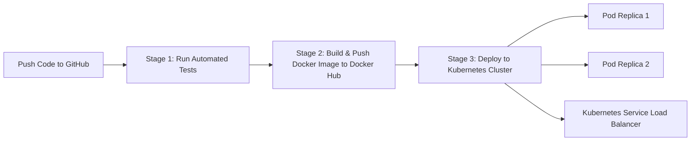

# ☸️ Cloud-Native CI/CD Pipeline (GitHub, Docker & Kubernetes)

A complete **Continuous Integration & Continuous Deployment (CI/CD)** pipeline for a cloud-native application using **GitHub**, **GitHub Actions**, **Docker**, **Docker Hub**, and **Kubernetes** prac.

---

## 🎯 What We Can Do In This Project (Practical Capabilities)

| Component | Role in Pipeline | Key Features Demonstrated |
|---|---|---|
| **GitHub** | Source Code Management | Branch management (`master`/`main`), commit triggers, pull request checks, manual triggers (`workflow_dispatch`). |
| **GitHub Actions** | Automated CI/CD Engine | 3-stage automated pipeline: Code Testing ➔ Container Build & Push ➔ Kubernetes Deployment & Verification. |
| **Docker** | Containerization | Packaging the application into a lightweight `node:20-alpine` image with clean layer caching. |
| **Docker Hub** | Container Registry | Secure automated authentication via Secrets, version tagging (`latest` and `sha-<commit>`), public image repository. |
| **Kubernetes** | Orchestration & Deployment | Declarative manifests (`k8s/deployment.yaml`, `k8s/service.yaml`), 2 Pod replicas, self-healing `/health` probe, NodePort Service, and zero-downtime rolling updates. |

---

## 💡 Architecture & Workflow



1. **Stage 1 (Continuous Integration)**: Developer pushes code. GitHub Actions automatically installs dependencies and runs unit tests (`npm test`).
2. **Stage 2 (Image Build & Push)**: GitHub Actions authenticates with Docker Hub using repository secrets, builds the Docker image, and tags it with both `:latest` and Git commit SHA.
3. **Stage 3 (Continuous Deployment to Kubernetes)**: GitHub Actions provisions a Kubernetes cluster, applies the `deployment.yaml` and `service.yaml`, performs a rolling update, and verifies that all replicas are healthy with `kubectl rollout status`.

---

## 📂 Project Structure

```text
├── .github/workflows/
│   └── ci-cd.yml          # Automated 3-Stage CI/CD Pipeline
├── k8s/
│   ├── deployment.yaml    # Kubernetes Deployment (2 Pod Replicas + Health Probe)
│   └── service.yaml       # Kubernetes Service (NodePort: 30080)
├── test/
│   └── app.test.js        # Unit test suite
├── server.js              # Cloud-native Express app with dashboard & /health probe
├── Dockerfile             # Container definition (node:20-alpine)
├── docker-compose.yml     # Local multi-container verification
├── package.json           # Application dependencies & test scripts
└── README.md
```

---

## 🚀 How to Execute & Verify the Practical

### 1. View the Automated Pipeline on GitHub
* Go to: **[https://github.com/HarshS3/devops-cicd/actions](https://github.com/HarshS3/devops-cicd/actions)**
* All 3 stages run automatically on every push or manual trigger:
  - `🧪 Run Automated Tests`
  - `🐳 Docker Build & Push`
  - `☸️ Deploy to Kubernetes`

### 2. View the Published Image on Docker Hub
* Go to: **[https://hub.docker.com/r/harshs3/simple-cloud-app](https://hub.docker.com/r/harshs3/simple-cloud-app)**
* Run on any machine with:
  ```bash
  docker run -d -p 8080:8080 harshs3/simple-cloud-app:latest
  ```

### 3. Run Kubernetes Manifests Locally (Optional)
If you enable Kubernetes in Docker Desktop (**Settings** ➔ **Kubernetes** ➔ **Enable Kubernetes**):
```bash
kubectl apply -f k8s/deployment.yaml
kubectl apply -f k8s/service.yaml
kubectl get pods -o wide
kubectl get services
```
