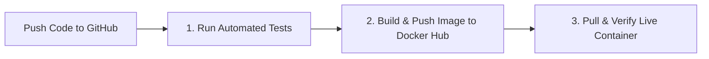

# 🐳 Simple Docker CI/CD Pipeline

A lightweight, minimal **Continuous Integration and Continuous Deployment (CI/CD)** pipeline using **GitHub**, **GitHub Actions**, **Docker**, and **Docker Hub**.

---

## 💡 How It Works (3 Stages)



1. **Stage 1 (Test)**: Runs automated tests (`npm test`) on every push to `master`/`main`.
2. **Stage 2 (Build & Push)**: Authenticates to Docker Hub, builds the container image, and pushes it with `:latest` and `:sha-<commit>` tags.
3. **Stage 3 (Verify Container)**: Pulls the published image from Docker Hub, launches it as a live container, and tests the `/health` endpoint to ensure it runs properly.

---

## 📂 Project Structure

```text
├── .github/workflows/
│   └── ci-cd.yml          # Complete Docker CI/CD pipeline
├── test/
│   └── app.test.js        # Automated test file
├── server.js              # Express app with web UI & /health endpoint
├── Dockerfile             # Clean, minimal Dockerfile
├── docker-compose.yml     # Local 1-command testing
├── package.json           # Lightweight configuration
└── README.md
```

---

## ⚡ Setup & Run

### 1. Configure GitHub Secrets
In your GitHub repo (**Settings** ➔ **Secrets and variables** ➔ **Actions**), add:
- `DOCKERHUB_USERNAME`: `harshs3`
- `DOCKERHUB_TOKEN`: Your Docker Hub Personal Access Token (or password)

### 2. Test Locally
```bash
# Run tests
npm test

# Run with Docker locally
docker compose up --build
```
Open **[http://localhost:8080](http://localhost:8080)** to view the live app.

### 3. Deploy
Push changes to your repository:
```bash
git add .
git commit -m "feat: docker-only CI/CD pipeline"
git push origin master
```
GitHub Actions will automatically run the tests, push the image to Docker Hub, and verify that the container is healthy!
