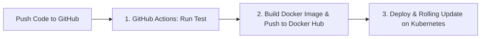

# 🚀 Simple Cloud-Native CI/CD Pipeline

A minimal, easy-to-understand **Continuous Integration and Continuous Deployment (CI/CD)** pipeline using **GitHub**, **GitHub Actions**, **Docker**, **Docker Hub**, and **Kubernetes**.

---

## 💡 How It Works (3 Simple Stages)



1. **Continuous Integration (CI)**: When you push code to GitHub, GitHub Actions runs the test (`npm test`).
2. **Containerization**: If the test passes, it builds the Docker image and pushes it to your **Docker Hub** repository.
3. **Continuous Deployment (CD)**: GitHub Actions authenticates with your **Kubernetes** cluster and deploys the new image with zero downtime.

---

## 📂 Simplified Project Structure

```text
├── .github/workflows/
│   └── ci-cd.yml          # The complete 3-step CI/CD pipeline
├── k8s/
│   ├── deployment.yaml    # Kubernetes Deployment (2 Pod replicas)
│   └── service.yaml       # Kubernetes Service (NodePort: 30080)
├── test/
│   └── app.test.js        # Simple test
├── server.js              # Lightweight Express app with UI + /health check
├── Dockerfile             # 10-line clean Dockerfile
├── docker-compose.yml     # For 1-click local testing
├── package.json           # Minimal configuration
└── README.md
```

---

## ⚡ Quick Start

### 1. Run & Test Locally
```bash
# Install dependencies
npm install

# Run the test
npm test

# Run the app locally
npm start
```
Open **[http://localhost:8080](http://localhost:8080)** to view the web dashboard or **[http://localhost:8080/health](http://localhost:8080/health)** for the health check.

---

### 2. Run with Docker
```bash
# Build and run with Docker Compose
docker compose up --build
```

---

### 3. Connect to GitHub & GitHub Actions

Add these 3 secrets to your GitHub repository (**Settings** -> **Secrets and variables** -> **Actions**):

| Secret Name | Description | Example |
|---|---|---|
| `DOCKERHUB_USERNAME` | Your Docker Hub account username | `johndoe` |
| `DOCKERHUB_TOKEN` | Docker Hub Personal Access Token | `dckr_pat_xxx` |
| `KUBE_CONFIG` | Base64 encoded Kubernetes config | `YXBpVmVyc2lvbj...` |

> **How to get the base64 Kubeconfig?**
> - **Windows (PowerShell)**: `[Convert]::ToBase64String([IO.File]::ReadAllBytes("$HOME\.kube\config"))`
> - **Linux / Mac**: `cat ~/.kube/config | base64 -w 0`

---

### 4. Deploy!
Push any change to the `main` branch:
```bash
git add .
git commit -m "Deploy update"
git push origin main
```
Watch GitHub Actions automatically test, build, push to Docker Hub, and update your Kubernetes cluster!
